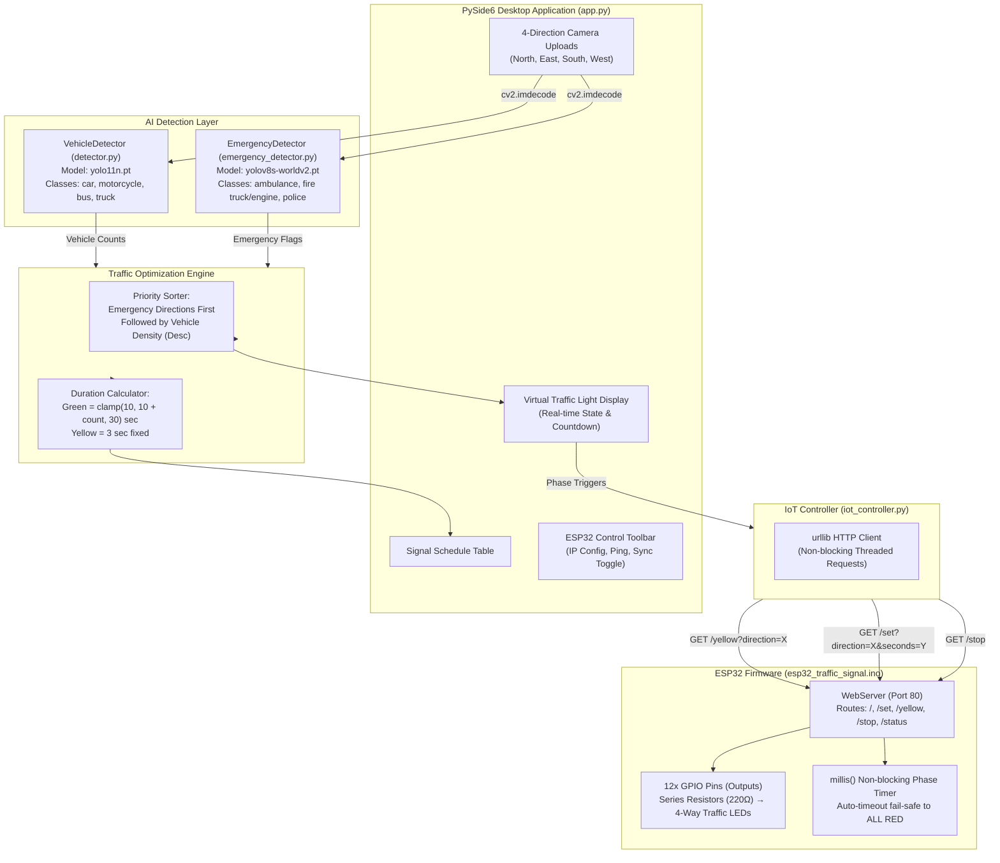

# AI Traffic Signal Control + ESP32 IoT — Comprehensive Codebase Analysis Report

---

## 1. Executive Summary

The **AI Traffic Signal Control + ESP32 IoT** project is an end-to-end intelligent transportation system that integrates deep learning computer vision with an embedded IoT hardware controller. The system dynamically computes traffic signal schedules based on visual vehicle density and automatically prioritizes emergency vehicles (ambulances, fire engines, police vehicles).

### Core Capabilities
* **Dual-Model Computer Vision**: Separates standard vehicle detection (YOLO11n) from zero-shot emergency vehicle recognition (YOLOv8s-Worldv2).
* **Dynamic Signal Scheduling**: Computes green phase durations according to detected vehicle volume and enforces strict emergency preemption.
* **Full-Featured Desktop GUI**: Built with PySide6 (Qt for Python), featuring custom traffic light widgets, interactive camera inputs, real-time countdown timers, and hardware controls.
* **IoT Hardware Synchronization**: Controls 12 traffic LEDs (North, East, South, West × Red, Yellow, Green) on an ESP32 microcontroller via RESTful HTTP calls over Wi-Fi.
* **Graceful Degradation / Simulation Mode**: Allows full operation and GUI testing even when the ESP32 hardware is offline.

---

## 2. System Architecture & Data Flow



---

## 3. Detailed Component Analysis

### 3.1. Main Application & GUI (`app.py`)
* **File Size**: ~26 KB | **Lines of Code**: 626
* **Key Class**: `TrafficApp(QMainWindow)`
* **Dependencies**: `PySide6`, `cv2`, `numpy`, `detector`, `emergency_detector`, `iot_controller`

#### Key Architectural Features:
1. **Model Lazy Initialization & Caching**:
   `VehicleDetector` and `EmergencyDetector` instances are loaded lazily upon first use and cached as private attributes (`self._vehicle_detector`, `self._emergency_detector`). This prevents costly multi-second re-instantiations on repeated calculation clicks.
2. **QImage Memory Safety**:
   In `show_image()`, the image buffer returned from OpenCV is converted using `QImage(...).copy()`. Without `.copy()`, Python's garbage collection can free underlying NumPy byte buffers while Qt holds a view, leading to memory corruption or crashes.
3. **Unicode Path Support**:
   Windows OpenCV `cv2.imread()` fails on paths with non-ASCII or localized characters. The helper `_imread_unicode()` uses `np.fromfile()` with `cv2.imdecode()` to ensure robust file loading across international character sets.
4. **Unified Phase State Machine**:
   A single `QTimer` firing at 1 Hz drives countdown transitions for both Yellow (3 seconds) and Green phases. The state machine transitions systematically:
   $$\text{Idle} \longrightarrow \text{Yellow (3s)} \longrightarrow \text{Green (N seconds)} \longrightarrow \text{Next Direction or Idle (All Red)}$$
5. **Custom GUI Widgets**:
   `TrafficLightWidget(QWidget)` renders realistic physical traffic lights with vertically stacked circles inside a stylized bezel housing, rendering active bulbs in high-contrast neon hues and inactive bulbs in dimmed hues.
6. **Thread Safety & Non-blocking Network I/O**:
   All network requests to the ESP32 (`_send_yellow_async`, `_send_signal_async`, `_send_stop_async`, `_ping_esp32`) are dispatched on background daemon threads (`threading.Thread(daemon=True)`). Callbacks to update UI states are marshaled back to the Qt main thread using `QTimer.singleShot(0, lambda: ...)`.

---

### 3.2. Vehicle Detector (`detector.py`)
* **File Size**: ~1.5 KB | **Lines of Code**: 39
* **Class**: `VehicleDetector`
* **Model**: YOLO11 nano (`yolo11n.pt`)

#### Implementation Breakdown:
* **Target Classes**: Scoped strictly to standard COCO vehicle categories: `{"car", "motorcycle", "bus", "truck"}`.
* **Confidence Threshold**: Set at `0.25`.
* **Inference Pipeline**: Passes images directly into `self.model.predict(source=image, conf=self.confidence, verbose=False)`.
* **Annotation**: Draws green bounding boxes (`(0, 255, 0)`) with label and confidence score overlay.

---

### 3.3. Emergency Vehicle Detector (`emergency_detector.py`)
* **File Size**: ~1.9 KB | **Lines of Code**: 55
* **Class**: `EmergencyDetector`
* **Model**: YOLO-World v2 Small (`yolov8s-worldv2.pt`)

#### Key Design Decisions:
1. **Open-Vocabulary Zero-Shot Detection**: Standard COCO models do not have specific classes for emergency vehicles (they simply group them as "truck" or "car"). YOLO-World allows setting custom text prompts at runtime.
2. **Specific Prompt Engineering**:
   ```python
   EMERGENCY_CLASSES = [
       "ambulance", "fire truck", "fire engine", "police car", "police vehicle"
   ]
   self.model.set_classes(EMERGENCY_CLASSES)
   ```
   The author intentionally avoids generic prompts like `"emergency vehicle"` to minimize false positives from utility vans or commercial service trucks.
3. **Higher Confidence & NMS Filtering**: Uses a higher threshold (`conf=0.60`, `iou=0.45`) to prevent false alarms that would improperly disrupt normal traffic flow.
4. **Structured Representation**: Employs Python `dataclass` (`EmergencyDetection`) holding `label`, `confidence`, and `box` coordinates.

---

### 3.4. IoT Wi-Fi Controller (`iot_controller.py`)
* **File Size**: ~3.4 KB | **Lines of Code**: 110
* **Protocol**: HTTP/1.1 REST client via standard library `urllib`

#### API Endpoints & Functions:
| Function | Endpoint | Description |
| :--- | :--- | :--- |
| `check_connection(timeout)` | `GET /` | Returns `True` if ESP32 responds within 2.0s |
| `send_yellow(direction)` | `GET /yellow?direction=<DIR>` | Instructs ESP32 to activate yellow LED for `<DIR>` |
| `send_signal(direction, sec)`| `GET /set?direction=<DIR>&seconds=<SEC>` | Activates green LED for `<DIR>` and starts ESP32 timer |
| `stop_signal()` | `GET /stop` | Immediately turns all directions RED |
| `get_status()` | `GET /status` | Returns parsed JSON status of active phase and remaining seconds |
| `set_esp32_ip(ip)` | N/A | Sanitizes string, strips protocols (`http://`), updates global `_ESP32_IP` |

#### Architectural Highlights:
* Fast timeout (`2.5` seconds) to avoid freezing UI threads if network frames drop.
* Dynamic URL generation via `get_base_url()` allowing real-time IP switching without application restarts.

---

### 3.5. ESP32 Microcontroller Firmware (`esp32_traffic_signal.ino`)
* **File Size**: ~11.6 KB | **Lines of Code**: 446
* **Platform**: Arduino framework on ESP32 (e.g., NodeMCU-32S / ESP32-WROOM-32)
* **Libraries**: `<WiFi.h>`, `<WebServer.h>`

#### GPIO Pinout Configuration:
| Intersection Leg | Red Pin | Yellow Pin | Green Pin | Default State |
| :--- | :---: | :---: | :---: | :---: |
| **NORTH** | GPIO 13 | GPIO 12 | GPIO 14 | Red (HIGH) |
| **EAST** | GPIO 27 | GPIO 26 | GPIO 25 | Red (HIGH) |
| **SOUTH** | GPIO 33 | GPIO 32 | GPIO 23 | Red (HIGH) |
| **WEST** | GPIO 19 | GPIO 18 | GPIO 5 | Red (HIGH) |

#### Firmware Logic & Safety Mechanisms:
1. **All-Red Failsafe Initialization**: `setup()` configures all 12 pins as `OUTPUT` and executes `allRed()`. At boot or disconnect, all directions are stopped.
2. **Rollover-Safe Timer Arithmetic**:
   Arduino's `millis()` overflows every ~49.7 days. The firmware uses signed subtraction:
   ```cpp
   if (running && (long)(millis() - endAt) >= 0) { allRed(); ... }
   ```
   This ensures mathematical safety across timer rollover events.
3. **Embedded Web Server & Monitoring Dashboard**:
   Serves an HTML5 dashboard with CSS dark-mode styling and `<meta http-equiv='refresh' content='2'>` at `http://<ESP32_IP>/`, displaying real-time bulb states and active API endpoints.
4. **CORS Headers**:
   All JSON API responses include `Access-Control-Allow-Origin: *` to support cross-origin browser requests.

---

### 3.6. Diagnostic & Automation Scripts

#### `test_esp32.py`
A standalone CLI verification utility that systematically tests 5 key milestones:
1. Root reachability check (`GET /`).
2. Yellow phase activation for North (`/yellow?direction=NORTH`).
3. Green phase activation for North for 5 seconds (`/set?direction=NORTH&seconds=5`).
4. Real-time JSON telemetry polling (`/status`) 5 times at 1-second intervals.
5. All-Red safe reset (`/stop`).

#### `RUN.bat` & `TEST_ESP32.bat`
* `RUN.bat`: Installs requirements via `py -3 -m pip install -r requirements.txt` and launches `app.py`.
* `TEST_ESP32.bat`: Direct shortcut to execute the diagnostic routine.

---

## 4. Traffic Control & Optimization Algorithm

### 4.1. Priority Queue Calculation
When the user clicks `CALCULATE TRAFFIC SIGNAL`:
1. Both models run inference across all 4 images.
2. Directions are partitioned into two priority sets:
   $$\mathcal{D}_{\text{emergency}} = \{ d \in \text{DIRECTIONS} \mid \text{has\_emergency}(d) = \text{True} \}$$
   $$\mathcal{D}_{\text{normal}} = \{ d \in \text{DIRECTIONS} \mid \text{has\_emergency}(d) = \text{False} \}$$
3. $\mathcal{D}_{\text{normal}}$ is sorted descending by vehicle count:
   $$\mathcal{D}_{\text{normal\_sorted}} = \text{sort\_descending}(\mathcal{D}_{\text{normal}}, \text{key}=\text{vehicles})$$
4. The final execution sequence is concatenated:
   $$\text{Sequence} = \mathcal{D}_{\text{emergency}} + \mathcal{D}_{\text{normal\_sorted}}$$

### 4.2. Green Time Duration Allocation
Green duration is dynamically scaled proportional to traffic volume, constrained by safety lower and upper bounds:
$$T_{\text{green}} = \min(30, \max(10, 10 + N_{\text{vehicles}}))$$
* **Minimum Green Time**: $10 \text{ seconds}$ (allows intersection clearance even with 0 detected vehicles).
* **Base Scaling**: $+1 \text{ second per vehicle}$.
* **Maximum Green Time Ceiling**: $30 \text{ seconds}$ (prevents starvation on competing intersection legs).

---

## 5. Architectural Strengths & Engineering Best Practices

1. **Separation of Concerns**:
   Standard vehicle counting (`detector.py`) is decoupled from zero-shot emergency detection (`emergency_detector.py`), ensuring that changing or retraining one model does not break the other.
2. **Resilient Hardware Fallback**:
   The desktop GUI never freezes when the ESP32 is absent or disconnected. If an HTTP request fails, the application displays `🔴 Offline — Simulation Mode` and completes the traffic sequence virtually.
3. **Double-Click / Race Condition Protection**:
   Action buttons (`CALCULATE` and `START SIGNAL SEQUENCE`) are disabled during active execution (`self.bstart.setEnabled(False)`) and re-enabled upon completion or abort (`stop_all()`).
4. **Hardware Protection**:
   The ESP32 firmware features an independent hardware timer. If Python crashes mid-sequence during a green phase, the ESP32 automatically reverts all lights to RED once the allocated seconds elapse.

---

## 6. Recommendations & Roadmap for Improvements

| Category | Finding / Limitation | Recommended Solution |
| :--- | :--- | :--- |
| **Security** | Wi-Fi credentials (`WIFI_SSID`, `WIFI_PASSWORD`) hardcoded in cleartext in `.ino`. | Utilize ESP32 `WiFiManager` library for captive-portal configuration or store in NVS/EEPROM. |
| **Networking** | State-mutating commands (`/set`, `/yellow`, `/stop`) use HTTP `GET`. | Refactor to HTTP `POST` with JSON bodies (`{"direction": "NORTH", "seconds": 30}`) matching REST standards. |
| **Input Source** | Static image upload only. | Integrate OpenCV `cv2.VideoCapture()` to ingest live RTSP/IP camera streams or USB webcams. |
| **Traffic Weighting** | 1 motorcycle is counted equally to 1 heavy commercial bus/truck. | Implement Passenger Car Equivalent (PCE/PCU) weights (e.g., Truck = 3.0, Bus = 2.5, Car = 1.0, Motorcycle = 0.5). |
| **Hardware Health** | If ESP32 Wi-Fi drops, it remains disconnected. | Add automatic reconnection loop in `loop()` or activate an amber blinking hazard mode when Wi-Fi is lost. |
| **Qt Architecture** | Uses raw `threading.Thread` with lambdas. | Transition to standard `QThread` with Qt `Signal` and `Slot` architecture for enhanced lifecycle management. |

---

## 7. File & Metric Summary Table

| File Name | Role | Language / Framework | Lines | Key Interfaces |
| :--- | :--- | :--- | :---: | :--- |
| [app.py](file:///c:/Users/Sakura/Pictures/AI_Traffic_Signal_Control_IoT_FULL/AI_Traffic_Signal_Control_IoT_FULL2/app.py) | GUI Application & State Machine | Python / PySide6, OpenCV | 626 | `TrafficApp`, `TrafficLightWidget` |
| [detector.py](file:///c:/Users/Sakura/Pictures/AI_Traffic_Signal_Control_IoT_FULL/AI_Traffic_Signal_Control_IoT_FULL2/detector.py) | Vehicle Detection & Counting | Python / Ultralytics YOLO11n | 39 | `VehicleDetector.detect()`, `annotate()` |
| [emergency_detector.py](file:///c:/Users/Sakura/Pictures/AI_Traffic_Signal_Control_IoT_FULL/AI_Traffic_Signal_Control_IoT_FULL2/emergency_detector.py) | Emergency Vehicle Recognition | Python / YOLO-World v2 | 55 | `EmergencyDetector.detect()`, `annotate()` |
| [iot_controller.py](file:///c:/Users/Sakura/Pictures/AI_Traffic_Signal_Control_IoT_FULL/AI_Traffic_Signal_Control_IoT_FULL2/iot_controller.py) | Hardware Wi-Fi Communication | Python / `urllib.request` | 110 | `send_signal()`, `send_yellow()`, `stop_signal()` |
| [test_esp32.py](file:///c:/Users/Sakura/Pictures/AI_Traffic_Signal_Control_IoT_FULL/AI_Traffic_Signal_Control_IoT_FULL2/test_esp32.py) | Hardware Diagnostics Test Suite | Python | 75 | `run_diagnostics()` |
| [esp32_traffic_signal.ino](file:///c:/Users/Sakura/Pictures/AI_Traffic_Signal_Control_IoT_FULL/AI_Traffic_Signal_Control_IoT_FULL2/esp32_traffic_signal/esp32_traffic_signal.ino) | Embedded Traffic Controller | C++ / ESP32 Arduino Core | 446 | `handleRoot()`, `handleYellow()`, `setSignal()`, `allRed()` |
| [requirements.txt](file:///c:/Users/Sakura/Pictures/AI_Traffic_Signal_Control_IoT_FULL/AI_Traffic_Signal_Control_IoT_FULL2/requirements.txt) | Python Dependencies | Text | 5 | `ultralytics`, `opencv-python`, `PySide6`, `numpy` |
| [RUN.bat](file:///c:/Users/Sakura/Pictures/AI_Traffic_Signal_Control_IoT_FULL/AI_Traffic_Signal_Control_IoT_FULL2/RUN.bat) | Launcher Script | Batch | 15 | Pip installation + app launch |
| [TEST_ESP32.bat](file:///c:/Users/Sakura/Pictures/AI_Traffic_Signal_Control_IoT_FULL/AI_Traffic_Signal_Control_IoT_FULL2/TEST_ESP32.bat) | Test Script | Batch | 5 | Runs `test_esp32.py` |

---
*Report generated automatically by Antigravity AI Code Analysis Engine.*
