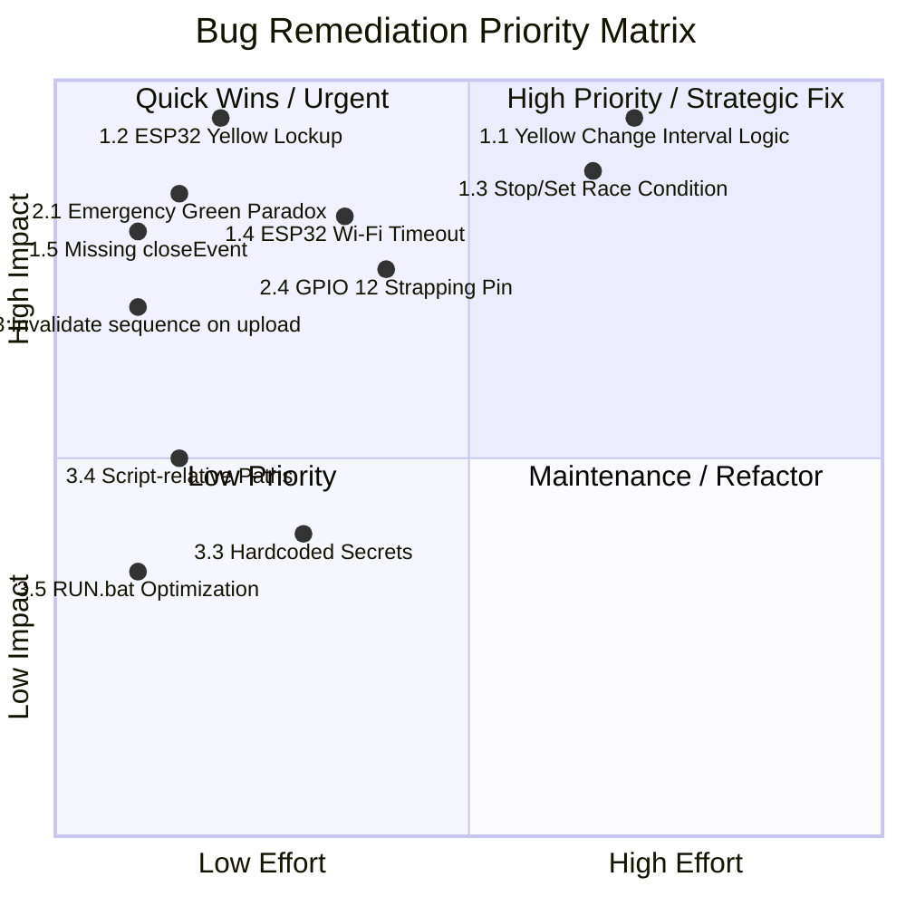

# Codebase Issues, Bugs, and Vulnerabilities Report

This document presents a comprehensive technical audit of the **AI Traffic Signal Control + ESP32 IoT** codebase. It details all identified critical bugs, algorithmic flaws, concurrency race conditions, hardware/firmware failure modes, and security vulnerabilities, along with recommended code solutions.

---

## Severity Classification Summary

| Level | Count | Description |
| :--- | :---: | :--- |
| **CRITICAL / HIGH** | **5** | Direct safety risks, infinite hardware lockups, network race conditions, missing cleanup |
| **MEDIUM** | **5** | Flawed emergency timing logic, arbitrary priority ties, obsolete state bugs, pin strapping risks |
| **LOW / ENHANCEMENT** | **5** | Unvalidated user inputs, socket exhaustion, hardcoded credentials, batch script inefficiency |

---

## 1. Critical & High Severity Bugs

### 1.1. Safety & Traffic Flow Bug: Zero Yellow Change Interval on Terminating Direction
* **File**: [app.py](file:///c:/Users/Sakura/Pictures/AI_Traffic_Signal_Control_IoT_FULL/AI_Traffic_Signal_Control_IoT_FULL2/app.py#L560-L566), [esp32_traffic_signal.ino](file:///c:/Users/Sakura/Pictures/AI_Traffic_Signal_Control_IoT_FULL/AI_Traffic_Signal_Control_IoT_FULL2/esp32_traffic_signal/esp32_traffic_signal.ino#L86-L113)
* **Location**: `TrafficApp._tick()`, `TrafficApp._start_current()`, `esp32_traffic_signal.ino:setYellow()`
* **The Issue**:
  In standard traffic engineering (FHWA / MUTCD standards), when a green phase terminates for an intersection leg, that leg MUST display **Yellow (Amber) for 3–5 seconds** to alert moving vehicles to decelerate and stop safely, followed by an **All-Red clearance interval (1–2s)**.
  
  In the current code:
  ```python
  # app.py:562-564
  elif self._phase == 'green':
      self.seq_index += 1
      self._start_current()
  ```
  When Direction 1's green timer expires, `_start_current()` immediately sets ALL directions to RED, and turns Direction 2 to YELLOW:
  ```python
  # app.py:534-535
  self._set_all_lights('red')
  self._set_light(d, 'yellow')  # d is Direction 2!
  ```
* **Consequence**:
  **Direction 1 transitions instantly from GREEN to RED with zero yellow warning.** Drivers travelling at speed are forced to either emergency-brake (causing rear-end collisions) or run red lights. Meanwhile, Yellow is incorrectly applied to the *incoming* direction before its green phase.
* **Fix**:
  Implement a proper 3-stage phase cycle per direction:
  $$\text{Direction}_i \text{ [GREEN]} \longrightarrow \text{Direction}_i \text{ [YELLOW (Change)]} \longrightarrow \text{ALL-RED (Clearance)} \longrightarrow \text{Direction}_{i+1} \text{ [GREEN]}$$

---

### 1.2. ESP32 Firmware Bug: Indefinite Yellow Light Freeze on Network/App Failure
* **File**: [esp32_traffic_signal.ino](file:///c:/Users/Sakura/Pictures/AI_Traffic_Signal_Control_IoT_FULL/AI_Traffic_Signal_Control_IoT_FULL2/esp32_traffic_signal/esp32_traffic_signal.ino#L178-L184)
* **Lines**: 178–184 & 436–445
* **The Issue**:
  When Python issues `/yellow?direction=NORTH`, the firmware executes:
  ```cpp
  // esp32_traffic_signal.ino:179-181
  setYellow(direction);
  running = false;
  endAt   = 0;
  ```
  Because `running` is set to `false`, the auto-expiry check in `loop()`:
  ```cpp
  // esp32_traffic_signal.ino:436
  if (running && (long)(millis() - endAt) >= 0)
  ```
  **never executes during a yellow phase.**
* **Consequence**:
  If the Python app crashes, freezes, drops Wi-Fi, or the computer enters sleep mode during the 3-second yellow phase, the ESP32 has **no hardware failsafe**. The physical Yellow LED remains permanently energized forever, risking hardware damage, overheating, or permanent intersection stall.
* **Fix**:
  Add an internal hardware timer to `handleYellow()`:
  ```cpp
  endAt   = millis() + 5000UL; // 5-second fail-safe timeout
  running = true;
  ```

---

### 1.3. Concurrency Race Condition: Request Reordering Between Stop and Set
* **File**: [app.py](file:///c:/Users/Sakura/Pictures/AI_Traffic_Signal_Control_IoT_FULL/AI_Traffic_Signal_Control_IoT_FULL2/app.py#L360-L381)
* **Lines**: 360–381, 603–619
* **The Issue**:
  `_send_signal_async()` and `_send_stop_async()` both spawn independent uncoordinated daemon threads:
  ```python
  def _send_signal_async(self, direction: str, seconds: int, callback=None):
      ...
      threading.Thread(target=_do, daemon=True).start()

  def _send_stop_async(self):
      ...
      threading.Thread(target=iot_controller.stop_signal, daemon=True).start()
  ```
  If the user clicks `STOP ESP32 / ALL RED` right as a new green phase is transitioning:
  1. Thread A (`send_signal(direction, seconds)`) is spawned.
  2. Thread B (`stop_signal()`) is spawned.
  3. Over Wi-Fi, Thread B (`/stop`) may arrive at the ESP32 first, setting ALL RED.
  4. Thread A (`/set`) arrives fractions of a second later, re-activating GREEN on the ESP32!
* **Consequence**:
  The GUI displays `🔴 ALL RED / STOPPED`, but the physical ESP32 turns GREEN and continues running.
* **Fix**:
  Use a sequence token / atomic counter or cancel pending background network tasks before sending `/stop`.

---

### 1.4. ESP32 Firmware Boot Lockup: Blocking Infinite Loop Without Wi-Fi Timeout
* **File**: [esp32_traffic_signal.ino](file:///c:/Users/Sakura/Pictures/AI_Traffic_Signal_Control_IoT_FULL/AI_Traffic_Signal_Control_IoT_FULL2/esp32_traffic_signal/esp32_traffic_signal.ino#L387-L391)
* **Lines**: 387–391
* **The Issue**:
  During boot in `setup()`:
  ```cpp
  WiFi.begin(WIFI_SSID, WIFI_PASSWORD);
  while (WiFi.status() != WL_CONNECTED)
  {
    delay(500);
    Serial.print(".");
  }
  ```
* **Consequence**:
  If the Wi-Fi router is temporarily off, the credentials have a typo, or the access point is out of range, the ESP32 enters an **infinite blocking loop**. It will never configure the web server, never report an error, and never start. Furthermore, if Wi-Fi disconnects during runtime, `loop()` lacks auto-reconnect logic.
* **Fix**:
  Add an attempt counter (e.g., 30 attempts = 15 seconds) to fallback gracefully to standalone/AP mode, and enable `WiFi.setAutoReconnect(true)`.

---

### 1.5. Missing Window Close Handler (`closeEvent`): Active Hardware Left Running
* **File**: [app.py](file:///c:/Users/Sakura/Pictures/AI_Traffic_Signal_Control_IoT_FULL/AI_Traffic_Signal_Control_IoT_FULL2/app.py#L603-L626)
* **The Issue**:
  The `TrafficApp` class does not override `closeEvent(event)`. If a user closes the desktop window while a sequence is running:
  1. The Python process terminates.
  2. `stop_all()` is never invoked.
  3. The ESP32 is never informed that the controlling application has exited.
* **Consequence**:
  If closed during Yellow phase, the ESP32 stays stuck on Yellow indefinitely (due to Bug 1.2). If closed during Green, the ESP32 runs until its internal timer finishes, without controlled shutdown.
* **Fix**:
  Implement `closeEvent`:
  ```python
  def closeEvent(self, event):
      self.stop_all()
      event.accept()
  ```

---

## 2. Medium Severity Algorithmic & Hardware Issues

### 2.1. Emergency Green Time Paradox: Emergency Vehicles Receive Minimum Green Duration
* **File**: [app.py](file:///c:/Users/Sakura/Pictures/AI_Traffic_Signal_Control_IoT_FULL/AI_Traffic_Signal_Control_IoT_FULL2/app.py#L458-L463)
* **Lines**: 458–463
* **The Issue**:
  The green time formula is based solely on vehicle count:
  ```python
  count = len(det)
  green = max(10, min(30, 10 + count))
  ```
* **Consequence**:
  If an ambulance is detected on an otherwise empty leg (`count = 0` or `1`), its green time is calculated as **only 10 seconds** (the bare minimum). Conversely, a normal leg with 20 cars receives 30 seconds. In reality, emergency vehicles require guaranteed maximum clearance time (or a dedicated priority duration, e.g. 25–30s) to clear the intersection and any leading queue.
* **Fix**:
  Override green duration when emergency is detected:
  ```python
  if len(em) > 0:
      green = 30  # Max clearance duration for emergency vehicles
  else:
      green = max(10, min(30, 10 + count))
  ```

---

### 2.2. Arbitrary Multi-Emergency Tie-Breaking
* **File**: [app.py](file:///c:/Users/Sakura/Pictures/AI_Traffic_Signal_Control_IoT_FULL/AI_Traffic_Signal_Control_IoT_FULL2/app.py#L484-L488)
* **Lines**: 484–488
* **The Issue**:
  ```python
  emergency = [d for d in DIRECTIONS if self.results[d]['emergency']]
  normal    = [d for d in DIRECTIONS if d not in emergency]
  normal.sort(key=lambda d: self.results[d]['vehicles'], reverse=True)
  self.sequence = emergency + normal
  ```
* **Consequence**:
  If emergency vehicles are detected in multiple directions (e.g. North and West), `emergency` preserves the hardcoded `DIRECTIONS` order (`['NORTH', 'EAST', 'SOUTH', 'WEST']`). It ignores both vehicle density on those legs and detection confidence.
* **Fix**:
  Sort the `emergency` list by vehicle count or highest emergency confidence.

---

### 2.3. Obsolete Sequence State on Re-upload
* **File**: [app.py](file:///c:/Users/Sakura/Pictures/AI_Traffic_Signal_Control_IoT_FULL/AI_Traffic_Signal_Control_IoT_FULL2/app.py#L410-L424)
* **Lines**: 410–424
* **The Issue**:
  When a user uploads a new image via `upload()`, `self.sequence` is not invalidated.
* **Consequence**:
  If a user uploads new images after running a calculation, but forgets to click `CALCULATE TRAFFIC SIGNAL` before clicking `START SIGNAL SEQUENCE`, the application executes the old schedule corresponding to previous images.
* **Fix**:
  Reset `self.sequence = []` and disable `self.bstart` inside `upload()`.

---

### 2.4. ESP32 Strapping Pin Vulnerability (GPIO 12)
* **File**: [esp32_traffic_signal.ino](file:///c:/Users/Sakura/Pictures/AI_Traffic_Signal_Control_IoT_FULL/AI_Traffic_Signal_Control_IoT_FULL2/esp32_traffic_signal/esp32_traffic_signal.ino#L27)
* **Line**: 27 (`const int NY = 12;`)
* **The Issue**:
  **GPIO 12 (`MTDI`) is an ESP32 strapping pin.** If GPIO 12 is driven HIGH during reset/power-on, it sets the internal SPI flash voltage to 1.8V instead of the standard 3.3V.
* **Consequence**:
  Depending on how the external LED / pull-up circuitry is wired to the North Yellow pin, the ESP32 can fail to boot, enter a continuous brownout reset loop, or fail to read flash memory.
* **Fix**:
  Avoid using GPIO 12 for external loads, or remap `NY` to a non-strapping general-purpose pin (e.g. GPIO 4, 16, or 17).

---

### 2.5. Broken / Outdated Helper `iot_controller.run_sequence()`
* **File**: [iot_controller.py](file:///c:/Users/Sakura/Pictures/AI_Traffic_Signal_Control_IoT_FULL/AI_Traffic_Signal_Control_IoT_FULL2/iot_controller.py#L103-L109)
* **Lines**: 103–109
* **The Issue**:
  ```python
  def run_sequence(sequence: list) -> bool:
      for direction, seconds in sequence:
          if not send_signal(direction, seconds):
              return False
          time.sleep(int(seconds))
      stop_signal()
      return True
  ```
* **Consequence**:
  This function does not trigger the yellow phase at all (`send_yellow()`), and uses blocking `time.sleep()`. If any external script relies on this public method, it bypasses the yellow phase and freezes caller threads.

---

## 3. Low Severity & Quality Issues

### 3.1. Missing ESP32 IP Format Validation
* **File**: [iot_controller.py](file:///c:/Users/Sakura/Pictures/AI_Traffic_Signal_Control_IoT_FULL/AI_Traffic_Signal_Control_IoT_FULL2/iot_controller.py#L19-L27), [app.py](file:///c:/Users/Sakura/Pictures/AI_Traffic_Signal_Control_IoT_FULL/AI_Traffic_Signal_Control_IoT_FULL2/app.py#L317-L325)
* **The Issue**:
  `set_esp32_ip()` strips whitespace and prefixes, but does not validate if the string is a valid IPv4 address or hostname. Entering an empty string or invalid text results in malformed URLs like `http:///set`.
* **Fix**:
  Add validation using Python's standard `ipaddress.ip_address` module.

---

### 3.2. HTTP Socket Churn (Lack of Connection Reuse)
* **File**: [iot_controller.py](file:///c:/Users/Sakura/Pictures/AI_Traffic_Signal_Control_IoT_FULL/AI_Traffic_Signal_Control_IoT_FULL2/iot_controller.py#L38-L44)
* **The Issue**:
  Every request calls `urllib.request.urlopen()`, opening and tearing down a new TCP connection on port 80.
* **Consequence**:
  The lightweight ESP32 `WebServer` has limited TCP PCB control blocks. Rapid requests can lead to `TIME_WAIT` socket exhaustion on the microcontroller.
* **Fix**:
  Use `http.client.HTTPConnection` with keep-alive, or `requests.Session()`.

---

### 3.3. Hardcoded Credentials in Microcontroller Firmware
* **File**: [esp32_traffic_signal.ino](file:///c:/Users/Sakura/Pictures/AI_Traffic_Signal_Control_IoT_FULL/AI_Traffic_Signal_Control_IoT_FULL2/esp32_traffic_signal/esp32_traffic_signal.ino#L7-L8)
* **The Issue**:
  ```cpp
  const char* WIFI_SSID     = "SAKURA0188";
  const char* WIFI_PASSWORD = "Sakura69";
  ```
* **Consequence**:
  Network credentials are plain text in source control.
* **Fix**:
  Use a `secrets.h` header added to `.gitignore` or the ESP32 `WiFiManager` captive portal library.

---

### 3.4. Hardcoded Model Path Sensitivity to Current Working Directory
* **File**: [app.py](file:///c:/Users/Sakura/Pictures/AI_Traffic_Signal_Control_IoT_FULL/AI_Traffic_Signal_Control_IoT_FULL2/app.py#L153-L165)
* **The Issue**:
  ```python
  self._vehicle_detector = VehicleDetector('yolo11n.pt', 0.25)
  self._emergency_detector = EmergencyDetector('yolov8s-worldv2.pt', 0.60)
  ```
* **Consequence**:
  If `app.py` is invoked from another working directory (e.g. `python AI_Traffic_Signal_Control_IoT_FULL2/app.py` from root `Pictures/`), it cannot find the weights in current working directory and will attempt to download them over the internet or throw file errors.
* **Fix**:
  Use script-relative paths:
  ```python
  BASE_DIR = os.path.dirname(os.path.abspath(__file__))
  yolo_path = os.path.join(BASE_DIR, 'yolo11n.pt')
  ```

---

### 3.5. Batch Script Re-installing Packages Every Launch
* **File**: [RUN.bat](file:///c:/Users/Sakura/Pictures/AI_Traffic_Signal_Control_IoT_FULL/AI_Traffic_Signal_Control_IoT_FULL2/RUN.bat#L4)
* **The Issue**:
  `RUN.bat` executes `py -3 -m pip install -r requirements.txt` on every run.
* **Consequence**:
  Causes a 3–8 second lag every time the application starts while `pip` checks PyPI metadata.
* **Fix**:
  Provide a dedicated `INSTALL.bat` for dependency installation, and keep `RUN.bat` lean for fast application launch.

---

## Action Plan & Recommended Priority Matrix



---
*Report prepared for AI Traffic Signal Control System.*
