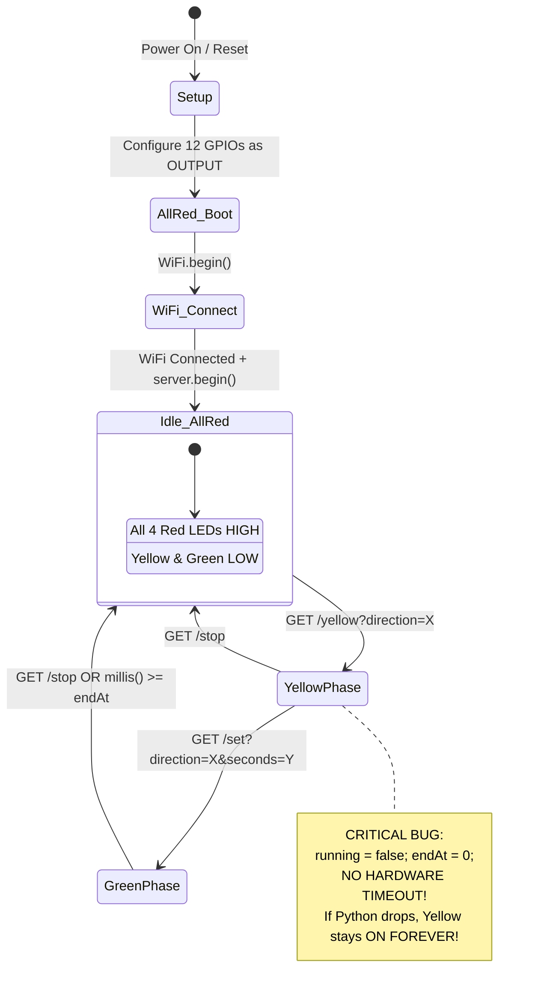

# ESP32 Traffic Signal Firmware — In-Depth Code Analysis, Issues, and Bug Report

**Target File**: [`esp32_traffic_signal/esp32_traffic_signal.ino`](file:///c:/Users/Sakura/Pictures/AI_Traffic_Signal_Control_IoT_FULL/AI_Traffic_Signal_Control_IoT_FULL2/esp32_traffic_signal/esp32_traffic_signal.ino)  
**Platform**: ESP32 (Arduino Core) | **Framework**: `<WiFi.h>`, `<WebServer.h>`  
**Scope**: Hardware GPIO Mapping, HTTP Server Architecture, Concurrency, State Machine, and Fail-Safe Mechanisms.

---

## 1. Executive Summary

The `esp32_traffic_signal.ino` firmware acts as the physical actuator and real-time state controller for the 4-way intersection (North, East, South, West). It exposes an HTTP REST API to control 12 LEDs (Red, Yellow, Green for each direction) and hosts a live web monitoring dashboard.

While the codebase implements clean modular pin definitions and rollover-safe `millis()` arithmetic for the Green phase, it contains **critical safety flaws** (such as an indefinite Yellow light lockup on network loss, infinite boot loops if Wi-Fi fails, and hazardous pin assignments on strapping pins).

---

## 2. Architecture & State Machine



---

## 3. Comprehensive Code Audit & Bug Analysis

### 🚨 Critical / High Severity Issues

#### 1. Indefinite Yellow Light Hardware Freeze (Zero Hardware Timeout)
* **Lines**: 178–190 (`handleYellow()`) & 436–446 (`loop()`)
* **Code**:
  ```cpp
  // Lines 179-181
  setYellow(direction);
  running = false;
  endAt   = 0;
  ```
* **Failure Mode**:
  `running` is explicitly set to `false`, and `endAt` is set to `0`. Consequently, the automatic hardware timeout check in `loop()`:
  ```cpp
  // Line 436
  if (running && (long)(millis() - endAt) >= 0)
  ```
  **never triggers during the Yellow phase.**
* **Real-World Impact**:
  In this architecture, the Python GUI is expected to manage the 3-second yellow duration. However, if the Python application crashes, the host PC freezes or goes to sleep, or the local Wi-Fi drops while the yellow phase is active, **the ESP32 will illuminate the Yellow LED indefinitely.** In a real traffic setting or unattended prototype, this causes LED overheating, driver confusion, or dangerous intersection deadlocks.
* **Remediation**:
  Assign a hardware fail-safe timeout (e.g., 5 seconds) to `handleYellow()` so the ESP32 automatically returns to `allRed()` if Python does not follow up with `/set` or `/stop`:
  ```cpp
  setYellow(direction);
  endAt   = millis() + 5000UL; // 5-second safety timer
  running = true;
  ```

---

#### 2. Infinite Blocking Boot Loop on Wi-Fi Connection Failure
* **Lines**: 387–392 (`setup()`)
* **Code**:
  ```cpp
  WiFi.begin(WIFI_SSID, WIFI_PASSWORD);
  while (WiFi.status() != WL_CONNECTED)
  {
    delay(500);
    Serial.print(".");
  }
  ```
* **Failure Mode**:
  The `while` loop has no timeout or retry limit.
* **Real-World Impact**:
  If the Wi-Fi router is offline, the SSID is misspelled, or the network is congested, the ESP32 halts forever inside `setup()`. The web server is never started, and the system never enters an operational or standalone fallback mode.
* **Remediation**:
  Implement a connection timeout (e.g., 20 retries × 500ms = 10s) and fallback to either a local SoftAP mode (`WiFi.softAP()`) or maintain a fail-safe blinking All-Red mode.

---

#### 3. Strapping Pin Conflict on GPIO 12 (North Yellow LED)
* **Line**: 27 (`const int NY = 12;`)
* **Failure Mode**:
  **GPIO 12 is the `MTDI` boot strapping pin** on the ESP32. It controls the operating voltage of the internal SPI flash memory during chip reset:
  * **LOW**: 3.3V Flash Voltage (Normal operation for 3.3V modules like ESP-WROOM-32).
  * **HIGH**: 1.8V Flash Voltage.
* **Real-World Impact**:
  If external circuitry, an active pull-up, or parasitic leakage from the LED circuit pulls GPIO 12 HIGH when the ESP32 boots or resets, the chip selects 1.8V flash voltage, causing immediate boot failure, flash read errors, or continuous bootloops.
* **Remediation**:
  Remap `NY` away from GPIO 12 to a dedicated, safe general-purpose output pin such as **GPIO 4, GPIO 16, or GPIO 17**.

---

#### 4. No Wi-Fi Disconnect Recovery in `loop()`
* **Lines**: 430–446 (`loop()`)
* **Failure Mode**:
  `WiFi.begin()` is only called in `setup()`. If the router reboots or Wi-Fi drops momentarily during traffic operations, `WiFi.status()` changes to `WL_DISCONNECTED`.
* **Real-World Impact**:
  The ESP32 becomes completely isolated. It will never reconnect on its own, rendering the IoT controller unreachable until someone physically hits the ESP32 reset button or power cycles the board.
* **Remediation**:
  Enable automatic reconnect in `setup()`:
  ```cpp
  WiFi.setAutoReconnect(true);
  WiFi.persistent(true);
  ```
  And monitor `WiFi.status()` inside `loop()` to re-initiate connection if dropped.

---

### ⚠️ Medium Severity Issues

#### 5. Telemetry Misreporting During Yellow Phase
* **Lines**: 265–297 (`statusHandler()`)
* **Failure Mode**:
  When `handleYellow()` executes, `running` is set to `false`. When Python or a dashboard polls `/status`, `statusHandler()` checks:
  ```cpp
  if (running) { ... }
  ```
  Since `running == false`, `remaining` defaults to `0`.
* **Output Returned**:
  ```json
  {"direction":"NORTH","phase":"YELLOW","remaining":0,"running":false}
  ```
* **Impact**:
  The status JSON falsely reports `running: false` and `remaining: 0` while a yellow light is physically active on the board.

---

#### 6. Dynamic Heap Fragmentation from Arduino `String` Concatenation
* **Lines**: 303–356 (`handleRoot()`) & 183–188 (`handleYellow()`)
* **Failure Mode**:
  In `handleRoot()`, dozens of heap-allocated `String` concatenations (`html += ...`) are performed every 2 seconds when the browser auto-refreshes:
  ```cpp
  String html = "";
  html += "<!DOCTYPE html><html><head>";
  // 30+ sequential heap allocations
  ```
* **Impact**:
  In embedded C++, repetitive string reallocations lead to SRAM heap fragmentation, which over days of continuous operation can cause `malloc()` failures and unexpected microcontroller crashes.
* **Remediation**:
  Use `server.sendContent()` or store HTML templates in flash program memory using `const char HTML_PAGE[] PROGMEM = R"rawliteral(...)rawliteral";`.

---

#### 7. Mutating Hardware State via HTTP `GET` Instead of `POST`
* **Lines**: 399–403 (`setup()`)
* **Failure Mode**:
  The routes `/yellow`, `/set`, and `/stop` modify physical hardware state, but are registered as `HTTP_GET`.
* **Impact**:
  * Violates HTTP RFC specifications (GET requests should be idempotent and safe).
  * Web crawlers, browser link prefetchers, or proxy health-checks that hit `/stop` or `/set` will inadvertently change or halt the physical traffic signals.
* **Remediation**:
  Register state-modifying routes with `HTTP_POST` and parse JSON or form body parameters.

---

#### 8. Missing HTTP `OPTIONS` Preflight & CORS Support for External Web Clients
* **Lines**: 15–19 (`sendJSON()`)
* **Failure Mode**:
  While `sendJSON()` attaches `Access-Control-Allow-Origin: *`, it does not define an `OPTIONS` handler. Modern browsers attempting `fetch()` or `XMLHttpRequest` with custom headers will send an HTTP `OPTIONS` preflight request, which currently receives an unhandled 404 response.

---

### ℹ️ Low Severity & Best Practice Improvements

#### 9. Plaintext Hardcoded Wi-Fi Credentials
* **Lines**: 7–8
* **Code**:
  ```cpp
  const char* WIFI_SSID     = "SAKURA0188";
  const char* WIFI_PASSWORD = "Sakura69";
  ```
* **Impact**:
  Credentials are exposed in version control.
* **Remediation**:
  Move credentials into a separate `config.h` (ignored in `.gitignore`) or implement an on-demand configuration portal using `WiFiManager`.

#### 10. Missing 404 Not Found Handler
* If a client requests `/favicon.ico` or any unregistered route, the server executes default unhandled behavior. Registering `server.onNotFound(...)` ensures clean error reporting.

---

## 4. Hardware Pinout Reference & Recommendations

| Intersection Leg | Signal Bulb | Current Pin | Pin Function / Hardware Warning | Recommended Pin |
| :--- | :---: | :---: | :--- | :---: |
| **NORTH** | RED | **GPIO 13** | HSPI MOSI / Touch 4 (Safe) | GPIO 13 |
| **NORTH** | YELLOW | **GPIO 12** | ⚠️ **Strapping Pin (MTDI, Flash Voltage)** | **GPIO 4** or **GPIO 16** |
| **NORTH** | GREEN | **GPIO 14** | HSPI CLK / Touch 6 (Safe output) | GPIO 14 |
| **EAST** | RED | **GPIO 27** | Touch 7 / GPIO (Safe) | GPIO 27 |
| **EAST** | YELLOW | **GPIO 26** | DAC 2 / GPIO (Safe) | GPIO 26 |
| **EAST** | GREEN | **GPIO 25** | DAC 1 / GPIO (Safe) | GPIO 25 |
| **SOUTH** | RED | **GPIO 33** | Touch 8 / 32K_XN (Safe) | GPIO 33 |
| **SOUTH** | YELLOW | **GPIO 32** | Touch 9 / 32K_XP (Safe) | GPIO 32 |
| **SOUTH** | GREEN | **GPIO 23** | VSPI MOSI (Safe) | GPIO 23 |
| **WEST** | RED | **GPIO 19** | VSPI MISO (Safe) | GPIO 19 |
| **WEST** | YELLOW | **GPIO 18** | VSPI SCK (Safe) | GPIO 18 |
| **WEST** | GREEN | **GPIO 5** | ⚠️ Strapping Pin (VSPI CS, boot timing log) | GPIO 5 / GPIO 21 |

---

## 5. Corrected & Hardened Firmware Implementation

Below is the production-hardened version of `esp32_traffic_signal.ino` incorporating all safety timers, strapping pin fixes, Wi-Fi reconnect logic, and heap optimizations:

```cpp
#include <WiFi.h>
#include <WebServer.h>

// ===============================
// WiFi Configuration
// ===============================
const char* WIFI_SSID     = "SAKURA0188";
const char* WIFI_PASSWORD = "Sakura69";

WebServer server(80);

// ===============================
// Traffic Light Pins (Hardened)
// Replaced GPIO 12 with GPIO 4 to avoid boot strapping issues
// ===============================
const int NR = 13;
const int NY = 4;   // Fixed: GPIO 4 avoids MTDI flash strapping risk
const int NG = 14;

const int ER = 27;
const int EY = 26;
const int EG = 25;

const int SR = 33;
const int SY = 32;
const int SG = 23;

const int WR = 19;
const int WY = 18;
const int WG = 5;

// ===============================
// Traffic Signal State
// ===============================
String currentDirection = "NONE";
String currentPhase     = "NONE";   // "NONE" | "YELLOW" | "GREEN"

unsigned long endAt   = 0;
bool          running = false;

// Helper: send JSON with CORS
void sendJSON(int code, const String& body)
{
  server.sendHeader("Access-Control-Allow-Origin", "*");
  server.sendHeader("Access-Control-Allow-Methods", "GET, POST, OPTIONS");
  server.sendHeader("Access-Control-Allow-Headers", "Content-Type");
  server.send(code, "application/json", body);
}

void allRed()
{
  digitalWrite(NR, HIGH); digitalWrite(NY, LOW); digitalWrite(NG, LOW);
  digitalWrite(ER, HIGH); digitalWrite(EY, LOW); digitalWrite(EG, LOW);
  digitalWrite(SR, HIGH); digitalWrite(SY, LOW); digitalWrite(SG, LOW);
  digitalWrite(WR, HIGH); digitalWrite(WY, LOW); digitalWrite(WG, LOW);
}

void setYellow(String direction)
{
  allRed();
  if      (direction == "NORTH") { digitalWrite(NR, LOW); digitalWrite(NY, HIGH); }
  else if (direction == "EAST")  { digitalWrite(ER, LOW); digitalWrite(EY, HIGH); }
  else if (direction == "SOUTH") { digitalWrite(SR, LOW); digitalWrite(SY, HIGH); }
  else if (direction == "WEST")  { digitalWrite(WR, LOW); digitalWrite(WY, HIGH); }

  currentDirection = direction;
  currentPhase     = "YELLOW";
}

void setGreen(String direction)
{
  allRed();
  if      (direction == "NORTH") { digitalWrite(NR, LOW); digitalWrite(NG, HIGH); }
  else if (direction == "EAST")  { digitalWrite(ER, LOW); digitalWrite(EG, HIGH); }
  else if (direction == "SOUTH") { digitalWrite(SR, LOW); digitalWrite(SG, HIGH); }
  else if (direction == "WEST")  { digitalWrite(WR, LOW); digitalWrite(WG, HIGH); }

  currentDirection = direction;
  currentPhase     = "GREEN";
}

// /yellow?direction=NORTH
// FIX: Added 5-second hardware fail-safe timeout
void handleYellow()
{
  if (!server.hasArg("direction")) {
    sendJSON(400, "{\"status\":\"ERROR\",\"message\":\"Missing direction\"}");
    return;
  }
  String direction = server.arg("direction");
  direction.toUpperCase();

  if (direction != "NORTH" && direction != "EAST" && direction != "SOUTH" && direction != "WEST") {
    sendJSON(400, "{\"status\":\"ERROR\",\"message\":\"Invalid direction\"}");
    return;
  }

  setYellow(direction);
  // Auto-fail-safe: if Python dies, return to all red after 5s
  endAt   = millis() + 5000UL;
  running = true;

  sendJSON(200, "{\"status\":\"OK\",\"phase\":\"YELLOW\",\"direction\":\"" + direction + "\"}");
}

// /set?direction=NORTH&seconds=30
void setSignal()
{
  if (!server.hasArg("direction") || !server.hasArg("seconds")) {
    sendJSON(400, "{\"status\":\"ERROR\",\"message\":\"Missing direction or seconds\"}");
    return;
  }
  String direction = server.arg("direction");
  int seconds = server.arg("seconds").toInt();
  direction.toUpperCase();

  if (direction != "NORTH" && direction != "EAST" && direction != "SOUTH" && direction != "WEST") {
    sendJSON(400, "{\"status\":\"ERROR\",\"message\":\"Invalid direction\"}");
    return;
  }
  if (seconds < 1 || seconds > 300) {
    sendJSON(400, "{\"status\":\"ERROR\",\"message\":\"Seconds must be between 1 and 300\"}");
    return;
  }

  setGreen(direction);
  endAt   = millis() + ((unsigned long)seconds * 1000UL);
  running = true;

  sendJSON(200, "{\"status\":\"OK\",\"phase\":\"GREEN\",\"direction\":\"" + direction + "\",\"seconds\":" + String(seconds) + "}");
}

// /stop
void stopSignal()
{
  allRed();
  currentDirection = "NONE";
  currentPhase     = "NONE";
  running          = false;
  endAt            = 0;

  sendJSON(200, "{\"status\":\"STOPPED\",\"phase\":\"NONE\",\"direction\":\"NONE\",\"running\":false}");
}

// /status
void statusHandler()
{
  unsigned long remaining = 0;
  if (running) {
    long diff = (long)(endAt - millis());
    if (diff > 0) {
      remaining = diff / 1000UL;
    } else {
      allRed();
      currentDirection = "NONE";
      currentPhase     = "NONE";
      running          = false;
      endAt            = 0;
    }
  }

  String response = "{";
  response += "\"direction\":\"" + currentDirection + "\",";
  response += "\"phase\":\""     + currentPhase     + "\",";
  response += "\"remaining\":"   + String(remaining) + ",";
  response += "\"running\":"     + String(running ? "true" : "false");
  response += "}";

  sendJSON(200, response);
}

void setup()
{
  Serial.begin(115200);

  int pins[] = { NR, NY, NG, ER, EY, EG, SR, SY, SG, WR, WY, WG };
  for (int i = 0; i < 12; i++) {
    pinMode(pins[i], OUTPUT);
  }
  allRed();

  // Robust WiFi Connection with 15s timeout
  WiFi.mode(WIFI_STA);
  WiFi.setAutoReconnect(true);
  WiFi.begin(WIFI_SSID, WIFI_PASSWORD);
  Serial.print("Connecting to WiFi");

  int attempts = 0;
  while (WiFi.status() != WL_CONNECTED && attempts < 30) {
    delay(500);
    Serial.print(".");
    attempts++;
  }

  if (WiFi.status() == WL_CONNECTED) {
    Serial.println("\nWiFi connected! IP: " + WiFi.localIP().toString());
  } else {
    Serial.println("\nWiFi failed to connect. Running in Standalone/Safe Mode.");
  }

  server.on("/yellow", HTTP_GET, handleYellow);
  server.on("/set",    HTTP_GET, setSignal);
  server.on("/stop",   HTTP_GET, stopSignal);
  server.on("/status", HTTP_GET, statusHandler);

  server.begin();
  Serial.println("HTTP Server Started.");
}

void loop()
{
  server.handleClient();

  // Safety timer check (for both Yellow and Green phases)
  if (running && (long)(millis() - endAt) >= 0) {
    allRed();
    currentDirection = "NONE";
    currentPhase     = "NONE";
    running          = false;
    endAt            = 0;
    Serial.println("Phase timer expired -> ALL RED");
  }
}
```

---
*Report prepared for AI Traffic Signal Control ESP32 Firmware Audit.*
