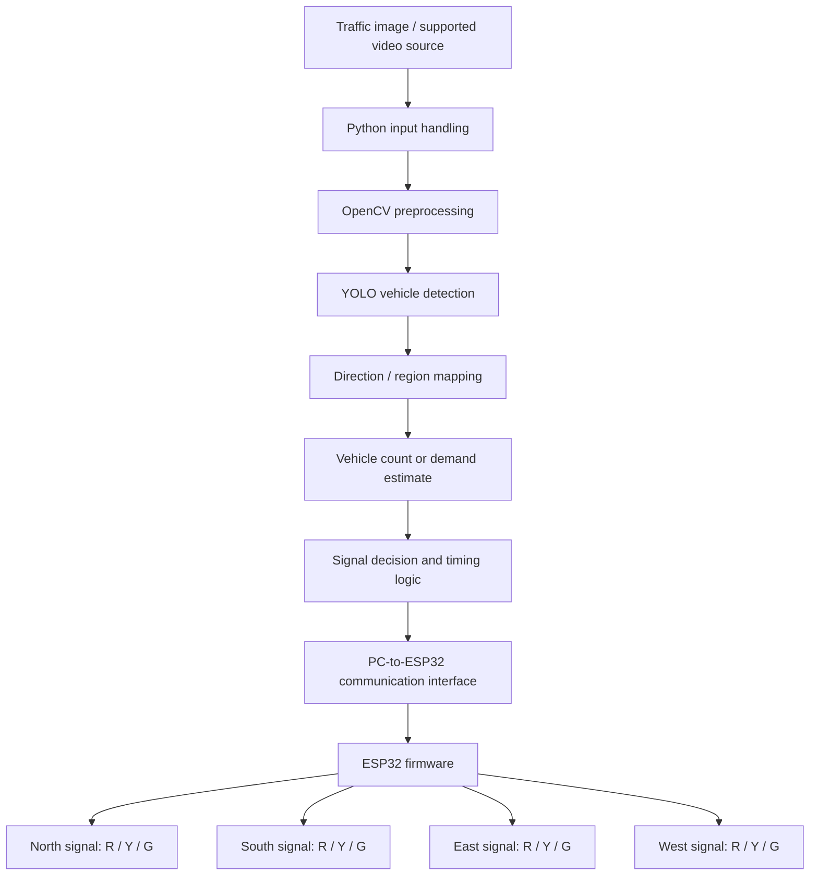
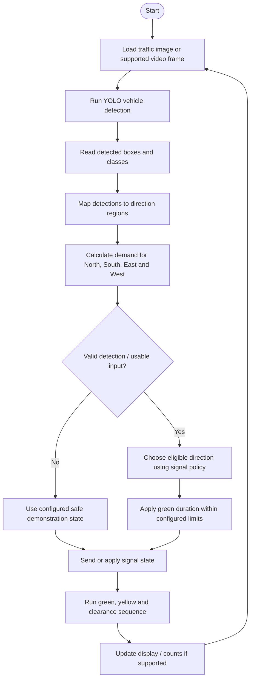
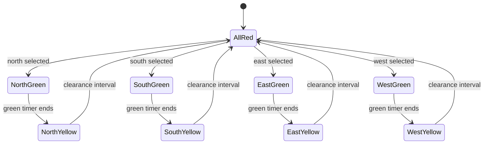
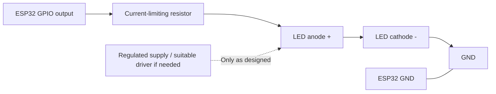

# AI-Based Intelligent Traffic Signal System

An educational traffic-management prototype that combines **YOLO object detection**, **OpenCV image processing**, and an **ESP32-controlled four-way LED traffic signal**. The computer-vision module analyses a traffic image or supported video source, estimates vehicle demand for each direction, and passes a signal decision to the ESP32 through the communication interface configured in the project.

> **Project type:** College mini project / proof of concept  
> **Primary platform:** Windows PC or laptop + ESP32 development board  
> **Computer vision:** Python, OpenCV, Ultralytics YOLO  
> **Signal demonstration:** 4 directions × Red / Yellow / Green LEDs

> [!IMPORTANT]
> This is an educational prototype. It is **not certified for real-world road traffic control**. Do not connect it to public-road traffic lights or rely on it for safety-critical decisions.

---

## Table of Contents

- [Overview](#overview)
- [Wokwi Simulator](#wokwi-simulator)
- [Problem Statement](#problem-statement)
- [Project Objectives](#project-objectives)
- [Key Features](#key-features)
- [System Architecture](#system-architecture)
- [Working Flow](#working-flow)
- [Traffic-Signal Decision Logic](#traffic-signal-decision-logic)
- [Hardware Requirements](#hardware-requirements)
- [Software Requirements](#software-requirements)
- [Suggested Repository Structure](#suggested-repository-structure)
- [Setup and Run](#setup-and-run)
- [ESP32 LED Connection Guidance](#esp32-led-connection-guidance)
- [Testing Checklist](#testing-checklist)
- [Limitations](#limitations)
- [Future Enhancements](#future-enhancements)
- [Troubleshooting](#troubleshooting)
- [Safety Notes](#safety-notes)
- [References](#references)
- [License](#license)

---

## Overview

Traditional traffic signals often use fixed timings. A fixed timer may give the same green-light duration to a road with very few vehicles and to a road with a long queue. This project explores a more adaptive approach by estimating vehicle demand from traffic imagery and using that estimate to inform a four-direction signal controller.

The prototype has two main parts:

1. **Vision and decision module — PC/laptop:** Python, OpenCV, and YOLO are used to detect vehicles in a supported traffic image or video source. The application can group detections by configured direction/region and calculate an estimated vehicle count.
2. **Signal-control module — ESP32:** The microcontroller runs the LED signal sequence for the North, South, East, and West approaches. The PC-to-ESP32 communication method and message format must match the actual application and firmware in the repository.

The LEDs represent a small demonstration intersection. This project demonstrates the concept of traffic-demand-aware control; real deployments would require reliable sensors, fail-safe controllers, validated timing plans, formal testing, and regulatory approval.

## Wokwi Simulator

Run the four-way ESP32 traffic-light simulation online without physical hardware:

[](https://wokwi.com/projects/478226018620545025)

**[▶ Open the ESP32 Traffic Signal Simulator on Wokwi](https://wokwi.com/projects/478226018620545025)**

The simulation represents North, East, South, and West with 12 LEDs in total—one Red, one Yellow, and one Green LED for each direction. It includes an automatic timed cycle and an ESP32 HTTP API.

### Open and run the simulation

1. Open the [Wokwi project](https://wokwi.com/projects/478226018620545025).
2. Check that `sketch.ino` and `diagram.json` match the firmware and wiring files in this repository.
3. Click **Start the Simulation** and open the Serial Monitor to view status messages.
4. If replacing the existing wiring, save a copy of the Wokwi project first.

### Wokwi signal timing

| Phase | Duration |
|---|---:|
| Green | 8 seconds |
| Yellow | 2 seconds |
| All-red clearance interval | 1 second |

### Simulator HTTP endpoints

| Endpoint | Purpose |
|---|---|
| `/` | Dashboard with manual controls |
| `/status` | Current direction, phase, remaining time, and mode |
| `/ping` or `/verify` | Connection health check |
| `/yellow?direction=NORTH` | Set the selected direction to yellow |
| `/set?direction=NORTH&seconds=8` | Set the selected direction to green for the requested duration |
| `/stop` | Stop cycling and set all signals to red |
| `/auto` | Resume automatic cycling |

**Wi-Fi note:** The simulation uses Wokwi's `Wokwi-GUEST` network. The LED automatic cycle works without Wi-Fi. Accessing the simulated ESP32 web server from your local computer or a local Python controller may require Wokwi's Private IoT Gateway because the public gateway does not accept incoming connections.

> The Wokwi project is for demonstration only and is not a certified real-world traffic controller. Check the linked project files against this README before claiming the public simulator has the latest code.

## Problem Statement

Fixed-time traffic lights may not respond to uneven traffic demand. The goal of this project is to demonstrate how vehicle detection can provide an estimate of traffic density and help choose an appropriate green-light duration for a direction in a miniature four-way intersection.

## Project Objectives

- Detect vehicles from a traffic image or supported video input using YOLO.
- Use OpenCV to prepare the input and display or process the detections.
- Estimate vehicle demand separately for each configured direction.
- Use the demand estimate as an input to a signal-selection and timing policy.
- Demonstrate four-way Red, Yellow, and Green light sequencing with an ESP32.
- Provide a modular prototype that can be tested and improved independently.

## Key Features

- **YOLO-based vehicle detection:** Identifies vehicle objects supported by the selected model and its class labels.
- **OpenCV processing:** Reads and prepares images/video frames and supports visualizing detection results.
- **Four-direction model:** North, South, East, and West approaches, each represented by Red, Yellow, and Green LEDs.
- **Demand-based decision concept:** Uses the estimated vehicle count or queue level to choose a direction and determine a green duration.
- **Microcontroller output:** ESP32 controls the physical demonstration LEDs.
- **Extendable design:** Can be expanded with camera input, emergency-vehicle priority, logging, or a dashboard.

**Important implementation note:** Features such as automatic emergency-vehicle priority, fines, live-camera operation, and real-time hardware communication should only be described as implemented when the corresponding code and hardware tests exist in this repository. Otherwise, treat them as future enhancements.

---

## System Architecture

The diagram below shows the intended high-level architecture. The exact communication method (for example, USB serial or Wi-Fi) depends on the PC application and ESP32 firmware used in the project.



### Main Modules

| Module | Responsibility | Typical technology |
|---|---|---|
| Input handling | Loads the traffic image or supported video frames | Python / OpenCV |
| Vehicle detector | Detects supported vehicle classes | Ultralytics YOLO |
| Direction mapper | Assigns detections to configured approaches or regions of interest | Python / OpenCV |
| Demand estimator | Calculates a per-direction count or score | Python |
| Signal decision logic | Selects a direction and timing within defined bounds | Python and/or ESP32 firmware |
| Communication interface | Sends the decision or control state to the ESP32 | Match the actual code: serial or Wi-Fi, for example |
| LED controller | Drives the miniature four-way signals | ESP32 firmware + LED driver circuitry as needed |

## Working Flow



**Direction mapping matters:** the detector does not automatically know which road a vehicle belongs to. Configure regions of interest (ROIs) for each approach according to the camera/image layout, and test them with sample images before relying on the counts.

## Traffic-Signal Decision Logic

A simple educational policy can use the estimated demand for each approach:

1. Detect vehicles in the input frame.
2. Assign each detection to a configured approach region.
3. Calculate the demand score for North, South, East, and West.
4. Select an eligible approach according to the scheduling policy.
5. Set the selected approach to green while the other approaches remain red.
6. Change green to yellow before changing the right of way.
7. Apply an all-red clearance interval, if implemented, before enabling another approach.
8. Repeat with updated input or after the configured cycle completes.

The signal policy should prevent conflicting movements from receiving green simultaneously. Add minimum/maximum green times, a starvation-prevention rule, and a deterministic fallback state. Tune timing values for the demonstration only; they are not real-road timing recommendations.

### Example Signal-State Sequence



This is an **illustrative sequence**, not a statement that every transition is already present in the current firmware. Update it if the actual firmware uses a different scheduling policy.

## Hardware Requirements

- ESP32 development board (the specific board variant should be recorded in the project notes).
- 12 LEDs for a simple four-way model: one Red, one Yellow, and one Green per direction.
- One current-limiting resistor per LED, selected for the LED and supply voltage.
- Breadboard and jumper wires.
- USB cable for programming and testing the ESP32.
- A suitable regulated external supply and driver circuitry if the total LED current exceeds what the board pins or supply can safely provide.
- PC or laptop to run the Python vision application.

## Software Requirements

- Windows, Linux, or macOS computer capable of running the Python application.
- Python environment compatible with the dependencies installed by the project.
- OpenCV (`opencv-python`) for image/video processing.
- Ultralytics (`ultralytics`) for YOLO inference, if this is the package used by the detector.
- The YOLO model weights required by the application. Use the exact filename expected by your code; do not assume the default model name if the project uses custom weights.
- Arduino IDE with the ESP32 board support package, or the firmware build environment already used by the project.
- `pyserial` only if the PC application communicates with the ESP32 over serial.

---

## Suggested Repository Structure

Use the real filenames from your code when you publish the repository. The following is a suggested organization, not a claim about the files currently in your project.

```text
ai-traffic-signal-system/
├── README.md
├── requirements.txt              # Python packages used by the application
├── .gitignore
├── python-app/
│   ├── main.py                   # Application entry point (rename if different)
│   ├── detection.py              # YOLO / OpenCV detection logic (if separated)
│   ├── signal_logic.py           # Demand-to-signal rules (if separated)
│   ├── config.py                 # Model path, ROIs, GPIO/port settings (if used)
│   └── sample-inputs/             # Small permitted sample images, if included
├── esp32-firmware/
│   └── traffic_signal.ino        # ESP32 firmware (rename if different)
├── docs/
│   ├── architecture.md           # Optional extended diagrams
│   └── wiring.md                 # Actual circuit and pin map
└── assets/
    ├── system-architecture.png    # Optional rendered diagram or project photo
    └── demo-screenshot.png        # Optional screenshot of the running application
```

Do not commit large model weights, private data, or traffic images/videos unless you have permission to redistribute them. If model files are too large for ordinary Git, document how to obtain them or use Git LFS where appropriate.

## Setup and Run

The commands below are a general starting point. Adapt the filenames, model path, communication settings, and start command to match your actual code.

### 1. Clone the repository

```bash
git clone https://github.com/<your-username>/<your-repository>.git
cd <your-repository>
```

### 2. Create and activate a Python virtual environment

On Windows Command Prompt:

```bat
python -m venv .venv
.venv\Scripts\activate
python -m pip install --upgrade pip
```

If `python` does not launch the intended version on Windows, use the Python launcher (for example, `py -3.11`) if that version is installed.

### 3. Install Python dependencies

If the repository includes a `requirements.txt` file:

```bat
python -m pip install -r requirements.txt
```

If you are setting up a minimal environment and your code uses these packages, a starting command is:

```bat
python -m pip install ultralytics opencv-python
```

Install `pyserial` only when the application uses serial communication:

```bat
python -m pip install pyserial
```

For GPU acceleration, install a PyTorch build that matches your operating system and CUDA configuration before testing inference. CPU inference may work but can be slower. Refer to the official Ultralytics installation guide for current instructions.

### 4. Configure the model and input source

- Set the YOLO weights path to the model filename used by your detector.
- Set the traffic image/video path or input device supported by the application.
- Configure the North, South, East, and West regions of interest to match the input viewpoint.
- If communicating with the ESP32, configure the correct COM port or network address and ensure the PC message format matches the firmware.

### 5. Upload the ESP32 firmware

1. Open the actual `.ino` file in Arduino IDE (or use the project's existing firmware toolchain).
2. Select the correct ESP32 board and USB/COM port.
3. Verify the LED pin definitions against the actual wiring.
4. Upload the sketch and test each LED output separately before running the full sequence.

Follow Espressif's official setup instructions if ESP32 board support is not installed.

### 6. Run the application

Use the real entry-point filename for this repository. For example, if the entry point is `main.py`:

```bat
python main.py
```

If your project is launched by a desktop executable, batch file, or a different Python script, document that exact command here before publishing. Confirm that the detector works with a sample input before enabling hardware output.

---

## ESP32 LED Connection Guidance

Each direction has three LED outputs:

| Direction | Red LED GPIO | Yellow LED GPIO | Green LED GPIO |
|---|---:|---:|---:|
| North | 13 | 12 | 14 |
| South | 33 | 32 | 23 |
| East | 27 | 26 | 25 |
| West | 19 | 18 | 5 |

These GPIO assignments match the Wokwi firmware described above. Before wiring physical hardware, verify the numbers against the exact ESP32 board, firmware version, and circuit you are using.

### Wiring concept



The diagram is conceptual. Follow the polarity markings and the actual circuit design. For a project with many LEDs, use a suitable driver stage or LED driver if needed; do not assume that a GPIO pin can supply the combined current of multiple LEDs.

## Testing Checklist

### Computer-vision tests

- [ ] The application loads the intended YOLO weights without an error.
- [ ] A known test image opens and produces visible detection results.
- [ ] The selected model detects the vehicle classes relevant to the test images.
- [ ] Direction regions of interest match the image layout.
- [ ] Vehicle counts are checked manually against a few sample images.
- [ ] Empty, blurry, crowded, and unsupported inputs are tested.

### Signal-control tests

- [ ] Each LED can be switched on and off independently.
- [ ] Only the intended direction receives green during each phase.
- [ ] Yellow appears before switching the right of way, according to the configured sequence.
- [ ] An all-red clearance phase is used if required by the chosen demonstration policy.
- [ ] Lost PC communication or invalid commands lead to a defined safe demonstration state.
- [ ] The controller does not switch rapidly due to noisy counts or repeated commands.

### Integration tests

- [ ] PC and ESP32 use matching port/network settings and message formats.
- [ ] A detection result produces the expected direction and timer in the application.
- [ ] The application and firmware agree on signal-state names and timing units.
- [ ] The demonstration is repeated across several traffic images or video frames.

---

## Limitations

- Detection quality depends on image resolution, camera angle, lighting, occlusion, model weights, and confidence thresholds.
- A single image gives a snapshot rather than a reliable continuous measurement of traffic flow.
- Direction-specific counts are only meaningful when regions of interest are configured correctly.
- A basic detector count is not the same as a fully measured queue length, waiting time, or lane occupancy.
- PC inference and hardware response depend on device performance and communication latency.
- The prototype does not replace a certified traffic controller and does not implement all safeguards required for public-road use.
- Legal enforcement or fine calculation is **not included by detection alone**; such a feature would require a separate, lawful, verified workflow and should not be claimed unless it is actually implemented.

## Future Enhancements

- Add a live camera input after image-based testing is stable.
- Improve queue estimation using object tracking and temporal smoothing.
- Add starvation prevention so a lower-traffic approach is not delayed indefinitely.
- Add a configurable emergency-vehicle detection and priority module, with careful false-positive handling and safe transition rules.
- Create a dashboard showing vehicle counts, active direction, remaining time, and event logs.
- Store test results and compare fixed-time versus demand-based signal policies.
- Add automated tests for the signal state machine and PC–ESP32 message parser.
- Document the exact hardware pin map, timing parameters, and model version used for the final demonstration.

## Troubleshooting

| Symptom | Possible cause | Suggested checks |
|---|---|---|
| YOLO model fails to load | Wrong weights path, missing package, or incompatible environment | Verify the file path, activate the intended virtual environment, and install project dependencies |
| No vehicles are detected | Unsupported classes, poor image quality, thresholds too high, or incorrect model | Test a known image, inspect class IDs, and check the confidence threshold and model weights |
| Counts are assigned to the wrong direction | Regions of interest do not match the image view | Draw/display ROI boundaries and validate each approach separately |
| ESP32 port is not visible | USB cable is charge-only, driver issue, or port occupied | Try a data-capable cable, inspect Device Manager, and close other serial-monitor applications |
| LEDs blink unexpectedly or all together | Wiring short, wrong GPIO mapping, unstable power, shared control wiring, or firmware timing/logic issue | Disconnect power before rewiring; test one LED at a time; verify GPIO definitions, grounds, resistors, and power capacity |
| PC detects vehicles but LEDs do not change | Communication configuration or protocol mismatch | Confirm the correct port/address, baud rate if serial is used, message format, and firmware parser |

## Safety Notes

- **Never connect a 9 V battery directly to an ESP32 GPIO pin or the 3.3 V rail.** Use only the input method and voltage range specified for the exact development board.
- Use a suitable current-limiting resistor for each LED unless a properly designed driver circuit provides the required current limiting.
- Do not power many LEDs directly from ESP32 GPIO pins. Check the board's electrical limits and use a suitable driver and regulated supply when needed.
- When an external supply powers the LED circuit and the design requires a shared signal reference, connect grounds as specified by the circuit. Avoid wiring changes while powered.
- Test this project on a miniature model only. Do not connect it to real traffic infrastructure.

## References

- [Ultralytics YOLO — official quickstart and installation](https://docs.ultralytics.com/quickstart/)
- [OpenCV — official documentation](https://docs.opencv.org/)
- [Espressif Arduino-ESP32 — getting started](https://docs.espressif.com/projects/arduino-esp32/en/latest/getting_started.html)

## License

Choose a license before publishing the repository. For example, the MIT License is a common option for open-source code, but only select it if you have the right to license all code and assets in the repository. Add the full license text in a `LICENSE` file and update this section accordingly.

---

## Before Publishing to GitHub

- [ ] Replace all example filenames and paths with your actual project filenames.
- [ ] Fill in the actual ESP32 GPIO pin numbers, baud rate or network settings, model filename, and timing values.
- [ ] Mark each feature as **implemented**, **in progress**, or **planned** based on the code you are uploading.
- [ ] Add your own project photos and a screenshot of the working application, if available.
- [ ] Remove private credentials, local file paths, personal data, and any traffic footage you do not have permission to publish.
- [ ] Add the selected license and a dependency file.
