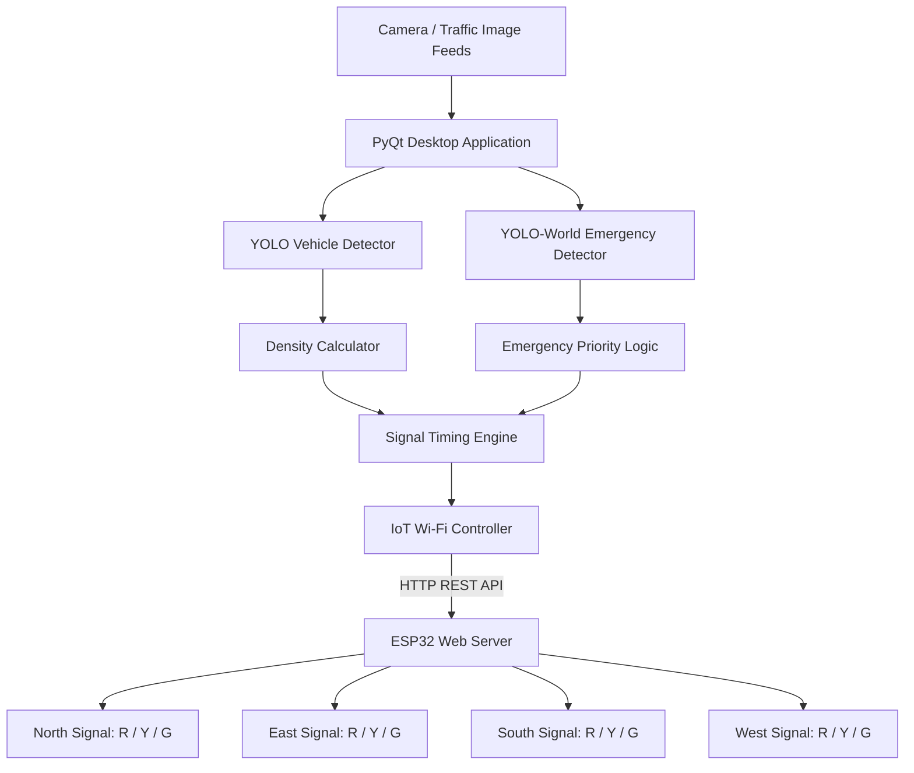
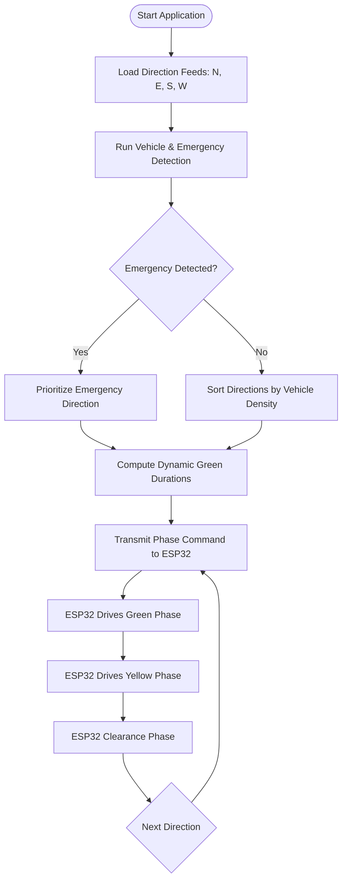

# AI-Based Intelligent Traffic Signal System

An intelligent traffic-management system combining **YOLO object detection**, **OpenCV image processing**, and an **ESP32-controlled four-way LED traffic signal**. The computer-vision module analyses traffic images or video sources, estimates vehicle demand for each direction, detects emergency vehicles with priority override, and coordinates signal timings with an ESP32 microcontroller over Wi-Fi.

---

## Table of Contents

- [Overview](#overview)
- [Problem Statement](#problem-statement)
- [Project Objectives](#project-objectives)
- [Key Features](#key-features)
- [System Architecture](#system-architecture)
- [Working Flow](#working-flow)
- [Traffic-Signal Decision Logic](#traffic-signal-decision-logic)
- [Hardware Pin Mapping](#hardware-pin-mapping)
- [Repository Structure](#repository-structure)
- [Setup and Run](#setup-and-run)
- [Testing Checklist](#testing-checklist)
- [Troubleshooting](#troubleshooting)
- [Safety Notes](#safety-notes)
- [References](#references)

---

## Overview

Traditional traffic signals operate on fixed timer intervals regardless of actual vehicle density. A fixed timer allocates the same green-light duration to an empty lane as it does to a congested lane. This project implements an adaptive traffic control system by estimating vehicle demand using computer vision and dynamically assigning green light durations.

The system consists of two primary modules:

1. **Vision & Decision Controller (PC):** Python, OpenCV, and YOLO detect standard vehicles and emergency vehicles across 4 intersection directions (North, East, South, West). The application calculates optimal green times and commands the microcontroller.
2. **Signal Controller (ESP32):** An ESP32 microcontroller hosts an HTTP REST server connected to a four-way traffic LED array, executing signal state changes (Green, Yellow, All-Red clearance) received from the PC controller over Wi-Fi.

---

## Problem Statement

Fixed-time traffic signals cause unnecessary delays, fuel wastage, and increased emissions at intersections. Furthermore, emergency vehicles (ambulances, fire engines, police vehicles) often get trapped in congested queues. This system dynamically measures queue levels per lane and grants priority clearance to emergency vehicles.

---

## Project Objectives

- Detect standard vehicles (cars, motorcycles, buses, trucks) using YOLO.
- Automatically detect emergency vehicles (ambulances, fire trucks, police cars) using YOLO-World open-vocabulary detection.
- Calculate real-time traffic density independently for North, East, South, and West lanes.
- Dynamically compute adaptive green durations based on queue volume.
- Automatically prioritize lanes containing emergency vehicles.
- Control a 4-way physical LED intersection via ESP32 over Wi-Fi.

---

## Key Features

- **Dual-Model Detection Pipeline:**
  - Standard vehicle detection via YOLO (`yolo11n.pt`).
  - Dedicated zero-shot emergency vehicle detector (`yolov8s-worldv2.pt`).
- **Dynamic Green Time Allocation:** Proportional green light duration (e.g. 10s minimum to 60s maximum) mapped to detected traffic density.
- **Emergency Vehicle Preemption:** Immediate lane priority override when an emergency vehicle is identified.
- **Wi-Fi REST Communication:** High-reliability HTTP communication between Python and ESP32 with fail-safe error handling.
- **Complete Four-Way GUI:** Interactive PyQt desktop interface displaying detection feeds, counts, active phases, and manual overrides.

---

## System Architecture



### Main Modules

| Module | File | Description |
|---|---|---|
| User Interface | `app.py` | PyQt desktop GUI showing camera feeds, statistics, and controls |
| Vehicle Detector | `detector.py` | YOLO vehicle detection for cars, motorcycles, buses, and trucks |
| Emergency Detector | `emergency_detector.py` | YOLO-World detector for ambulances, fire engines, and police vehicles |
| IoT Wi-Fi Controller | `iot_controller.py` | HTTP client communicating signal commands to ESP32 |
| Firmware | `esp32_traffic_signal.ino` | ESP32 Wi-Fi server driving 12 physical signal LEDs |
| Hardware Test | `test_esp32.py` | Standalone verification script for ESP32 connection and LEDs |

---

## Working Flow



---

## Traffic-Signal Decision Logic

1. **Detection:** Images or video feeds for North, East, South, and West are processed simultaneously.
2. **Prioritization:** Any lane with an identified emergency vehicle (ambulance, fire truck, police car) is moved to the front of the queue.
3. **Queue Sorting:** Remaining lanes are ordered in descending order of vehicle count.
4. **Timing Calculation:**
   $$\text{Green Time} = \text{clamp}\left(\text{Base Time} + (\text{Count} \times \text{Multiplier}), \text{Min Time}, \text{Max Time}\right)$$
5. **Execution:** The controller dispatches HTTP requests (`/set?direction=NORTH&seconds=X`) to the ESP32.
6. **Safety Clearance:** A yellow transition (3 seconds) is enforced between green switches to prevent conflicting movements.

---

## Hardware Pin Mapping

The ESP32 controls 12 LEDs (4 directions × 3 colors):

| Direction | Red LED | Yellow LED | Green LED |
|:---:|:---:|:---:|:---:|
| **NORTH** | GPIO 13 | GPIO 12 | GPIO 14 |
| **EAST**  | GPIO 27 | GPIO 26 | GPIO 25 |
| **SOUTH** | GPIO 33 | GPIO 32 | GPIO 23 |
| **WEST**  | GPIO 19 | GPIO 18 | GPIO 5  |

> Connect each LED through a **220-ohm resistor** to ground to limit forward current.


---

## Repository Structure

```text
AI_Traffic_Signal_Control_IoT/
├── app.py                      # Main desktop application & GUI
├── detector.py                 # Normal YOLO vehicle detector
├── emergency_detector.py       # Emergency vehicle detector (YOLO-World)
├── iot_controller.py           # Wi-Fi REST client for ESP32
├── test_esp32.py               # Hardware verification script
├── requirements.txt            # Python dependencies
├── RUN.bat                     # Windows one-click run script
├── TEST_ESP32.bat              # Windows one-click test script
├── .gitignore                  # Git ignore rules (excludes models >100MB)
└── esp32_traffic_signal/
    └── esp32_traffic_signal.ino # ESP32 Arduino firmware
```

---

## Setup and Run

### 1. Prerequisites
- Python 3.10+
- Arduino IDE with ESP32 board package installed
- ESP32 development board and 12 LEDs with resistors

### 2. Install Dependencies

```bash
pip install -r requirements.txt
```

### 3. Flash ESP32 Firmware
1. Open `esp32_traffic_signal/esp32_traffic_signal.ino` in Arduino IDE.
2. Enter your Wi-Fi SSID and Password:
   ```cpp
   const char* ssid = "YOUR_WIFI_SSID";
   const char* password = "YOUR_WIFI_PASSWORD";
   ```
3. Connect your ESP32 via USB and upload the sketch.
4. Open the Serial Monitor (115200 baud) to find the ESP32 IP address.

### 4. Configure ESP32 IP
Open `iot_controller.py` or set it in the GUI toolbar:
```python
_ESP32_IP: str = "YOUR_ESP32_IP"
```

### 5. Test Hardware Connection
Run the connection test:
```bash
python test_esp32.py
# Or double-click TEST_ESP32.bat
```

### 6. Launch Application
```bash
python app.py
# Or double-click RUN.bat
```

---

## Testing Checklist

- [x] YOLO standard vehicle detection active.
- [x] YOLO-World emergency vehicle detection active.
- [x] Wi-Fi communication verified between PC and ESP32.
- [x] North, East, South, West LEDs cycle correctly according to assigned schedule.
- [x] Yellow transition occurs before changing green direction.
- [x] Emergency preemption overrides standard queue ordering.

---

## Troubleshooting

| Issue | Cause | Solution |
|---|---|---|
| Model fails to load | Missing weights file or internet connection | Ensure internet is available on first launch so Ultralytics can download the weights |
| ESP32 connection error | IP address mismatch or PC on different network | Ensure PC and ESP32 are connected to the same Wi-Fi network and verify IP in Serial Monitor |
| LEDs dim or not turning on | Loose breadboard wiring or missing ground connection | Check LED polarity, verify 220Ω resistor connections, and ensure common ground |
| Port busy / timeout | Firewall blocking HTTP traffic | Allow Python through Windows Firewall on local private network |

---

## Safety Notes

- Use a **220-ohm current-limiting resistor** in series with each LED.
- Power the ESP32 using a stable 5V USB source.
- Never connect high-power mains traffic lamps directly to ESP32 GPIO pins; always use optocoupled relays or isolated motor/lamp drivers for external loads.

---

## References

- [Ultralytics YOLO Documentation](https://docs.ultralytics.com/)
- [OpenCV Documentation](https://docs.opencv.org/)
- [Espressif Arduino ESP32 Core](https://docs.espressif.com/projects/arduino-esp32/)
